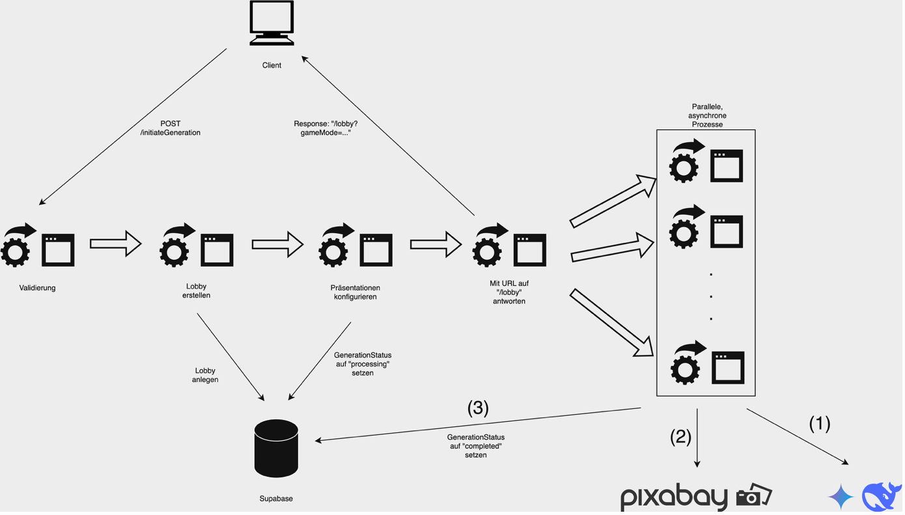

  

  

    <strong>FreestAIle – KI-gestützte PowerPoint-Karaoke</strong>
  

  

    <a href="#-about">About</a>
    <a href="#-tech-stack">Tech Stack</a>
    <a href="#-implementation">Implementation</a>
    <a href="#-structure">Webstruktur</a>
    <a href="#-design">Design</a>
  

---

## 📋 Table of Contents

- [About](#-about)
- [Tech Stack](#-tech-stack)
- [Implementation](#-implementation)
- [Webstruktur](#-structure)
- [Design](#-design)

---

## 🎯 About

Beim Spiel „PowerPoint Karaoke“ muss ein Spieler eine Präsentation halten, deren Foliensatz ihm zuvor völlig unbekannt ist. Bisher mussten die Präsentationen im Vorhinein des Spiels manuell erstellt werden, was spontane und unkomplizierte Spielrunden erschwert.

Dieses Problem soll mit der Webanwendung „FreestAIle“ (Freestyle + AI) gelöst werden. Sie ermöglicht es, per Knopfdruck Präsentationen mit einem gewählten oder zufälligen Thema von einem Large Language Model (LLM) für jeden Spieler einer Spielrunde zu generieren. Jede Präsentation wird dabei neu und individuell generiert und ist somit einzigartig.

Im Folgenden wird die technische Umsetzung und der strukturelle Aufbau und von FreestAIle beschrieben.

---

## 🛠 Tech Stack

### LLMs

In den letzten Monaten und Jahren wurden immer mehr LLMs und zugehörige API-Anbindungen verfügbar. Neben den prominenten GPT-Modellen von OpenAI gibt es auch u. a. Alternativen von Google (Gemini), Anthropic (Claude) und DeepSeek (R1).

Im Zuge dieses Projekts lag die Priorität auf möglichst günstigen Kosten bei noch akzeptablen Antwortzeiten. Zwei vollständig kostenlose APIs für LLMs erwiesen sich in diesem Zusammenhang als besonders vielversprechend:
- Gemini 2.0 Flash von Google
- DeepSeek R1 0528 (Free) von OpenRouter

Nach ausgiebigen Tests wurde festgestellt, dass die Antwortqualität, Antwortdauer sowie Verfügbarkeit durchaus ausreichend für das Projekt sind.

### Präsentation

In unserer Web-App generieren wir Präsentationen automatisch mithilfe von Künstlicher Intelligenz. Reveal.js hat sich in diesem Zusammenhang als die beste Lösung erwiesen aus mehreren wichtigen Gründen.

Die oft naheliegende Alternative, Microsoft PowerPoint, bringt in unserem Fall erhebliche Einschränkungen mit sich. Es existiert aktuell kein kostenloses KI-Modell, welches direkt vollwertige PowerPoint-Dateien erzeugen kann. Zudem ist PowerPoint nicht dafür konzipiert, automatisiert per Code befüllt zu werden – die Integration ist aufwändig und erfordert Workarounds über COM-Objekte oder Drittanbieter-Tools. Für eine webbasierte, KI-gesteuerte Anwendung ist das nicht praktikabel.

Reveal.js dagegen bietet eine moderne, webbasierte Plattform, die exakt zu unserem Anwendungsfall passt:
- Einfache Integration mit generativer KI: Da Reveal.js auf HTML und CSS basiert, kann unser KI-System direkt den vollständigen Quellcode für eine Präsentation erzeugen.
- Web-native Darstellung: Präsentationen laufen sofort im Browser – ohne Konvertierung, Software-Installation oder Export.
- Hohe Flexibilität und Erweiterbarkeit: Reveal.js erlaubt individuelle Designs, Animationen und sogar interaktive Inhalte durch JavaScript.
- Automatisierbarkeit und Skalierbarkeit: Präsentationen lassen sich automatisch erstellen, speichern und laden – ideal für den KI-Workflow.

Reveal.js erlaubt es uns, Präsentationen vollständig im Browser bereitzustellen – ohne den Einsatz externer Software.

### Datenbank

Im Rahmen dieses Projektes ist es auch notwendig, verschiedene Daten persistent in einer Datenbank zu speichern. Dies betrifft vor allem die Präsentationen, damit sie während und nach einer Spielrunde immer wieder abgerufen werden können. Zusätzlich ist die Datenbank für Nutzerdaten nötig, um eine Registrierung und einen Login anzubieten.

Die Open-Source-Plattform „Supabase“ bietet hier eine effiziente und kostenlose Lösung: Sie stellt eine vollständig verwaltete Backend-Infrastruktur bereit, die auf PostgreSQL basiert und out-of-the-box Funktionen wie Authentifizierung (Registrierung, Login, Passwort-Reset), Datenbankzugriff, Echtzeitfunktionen und Storage bietet. Zudem ist bereits eine JavaScript-Bibliothek verfügbar, die Datenbankzugriffe mit wenigen Codezeilen ermöglicht.

### Template-Engine

Um unsere Webanwendung mit variablen Inhalten zu füllen, wird eine Template-Engine benötigt, die dynamisch HTML generiert. Obwohl es dafür viele verschiedene Lösungen gibt, bot sich für dieses Projekt „Eta“ an. Die Entscheidung fiel auf Eta aufgrund seiner schlanken Struktur, hohen Performance und der einfachen Integration in unsere Express.js-basierte Architektur.

### Bilder

Teil der Anforderungen war auch, dass Bilder in die Präsentationen eingefügt werden. Hierfür gibt es grundsätzlich zwei Möglichkeiten:
1. Eine Bilder-Suchmaschine, die existierende Bilder liefert
2. Eine Bild-Generierungs-KI, die Bilder neu erstellt

Da APIs zu Generierung von Bildern kostenaufwendig sind und die Antwortzeiten nicht optimal im Zusammenhang dieses Projektes waren, wurde erstere Möglichkeit gewählt. Hierfür bot sich die kostenlose Pixabay-API an, die auf Basis von Such-Schlagwörtern passende Bilder zurückliefert. Ein weiterer Pluspunkt ist, dass die Bilder lizenzfrei sind und damit problemlos verwendet werden dürfen.

---

## ⚙️ Implementation

### Prozess zur Generierung der Folien

Der komplette Generierungsprozess ist im POST-Endpunkt `/initiateGeneration` implementiert. Dieser Endpunkt wird beim Erstellen einer Lobby (im Mehrspielermodus) aufgerufen.

Es werden die gewünschte Sprache, die zugehörige Account-ID, die Präsentationsdaten (Spielername und Thema) sowie der Gamemode (Ein-Gerät- oder Mehr-Geräte-Modus) im Body übergeben.

Anschließend werden die Eingaben validiert. Es wird sichergestellt, dass mindestens eine Präsentation übermittelt wurde und jedes Thema zwischen 3 und 50 Zeichen lang ist. Außerdem wird für jedes Thema, das der Nutzer als „Zufällig“ ausgewählt hat, ein zufälliges eingesetzt. Hierfür wird `topics.json` genutzt, wo 500 Themen zur Verfügung stehen.

Daraufhin wird eine Lobby mit einer eindeutigen `roundID` erstellt und die Rundendaten in der Datenbank gespeichert.

Außerdem wird für jede zu generierende Präsentation eine eindeutige `presentationID` erzeugt, unter der ihr aktueller Generierungsstatus abgefragt (am Anfang „processing“) und die Präsentation selbst später abgerufen werden kann.

Schließlich erhält der Nutzer-Client eine URL auf den `/lobby`-Endpunkt, auf die er weitergeleitet wird und auf der er den Generierungsstatus der Präsentation verfolgen kann.

Abschließend wird für jede Präsentation parallel folgender asynchroner Prozess gestartet:
1. Inhalt der Präsentation generieren (Hierbei werden Google Gemini und DeepSeek gleichzeitig angefragt, und die schnellere Antwort verwendet.)
2. Bilder einfügen (Hierbei werden die Keywords aus dem alt-Tag der `img`-Elemente verwendet.)
3. Präsentation in der Datenbank speichern
4. Aktualisierung des Generierungsstatus auf „completed“

---

### Multiplayer

Die Multiplayer-Funktionen basieren auf einer Kombination aus serverseitiger Logik, WebSockets, Datenbankunterstützung und einer benutzerfreundlichen Beitrittsmethode über QR-Codes.

- **Express.js Backend**: Dient der Bereitstellung von HTTP-Endpunkten, z. B. zum Erstellen oder Verwalten von Lobbys.
- **Socket.IO**: Ermöglicht die bidirektionale Echtzeit-Kommunikation zwischen Host und Teilnehmern.
- **Supabase**: Wird zur persistenten Speicherung von Lobby-Daten, Spielstatus und Präsentationen verwendet.
- **QR-Code-System**: Erlaubt einen schnellen und unkomplizierten Lobby-Beitritt über mobile Endgeräte.

#### Ablauf:

1. **Lobby erstellen**  
   Der Host startet den Mehrspieler-Modus über den Endpunkt `/multi-device-mode`. Dabei wird eine eindeutige Lobby-ID generiert und als QR-Code dargestellt. Gleichzeitig wird die Lobby in der Supabase-Datenbank registriert.

2. **Spieler beitreten**  
   Spieler können über den QR-Code oder einen geteilten Link der Lobby beitreten. Der Beitritt wird automatisch erkannt und alle Teilnehmer erhalten über Socket.IO ein Live-Update zur aktualisierten Teilnehmerliste.

3. **Präsentationen generieren**  
   Der Host wählt Themen für die Teilnehmer aus. Anschließend werden die Präsentationen im Hintergrund durch die KI generiert. Der Fortschritt jedes Teilnehmers wird in Echtzeit angezeigt.

4. **Spiel starten**  
   Sobald alle Präsentationen bereit sind, startet der Host das Spiel. Alle Spieler wechseln synchron in den Präsentationsmodus, wobei ihre individuellen Inhalte angezeigt werden.

   

---

### Accounts

Die Funktionen zum Registrieren, Ein- und Ausloggen sowie Konto löschen sind in den entsprechenden POST-Endpunkten `/api/auth/…` implementiert. Dabei werden jeweils die Daten aus dem Body gelesen, ggf. die Eingaben validiert und die entsprechende Supabase-API aufgerufen. Beim Login-Endpunkt erhält der Nutzer in der Antwort einen Cookie mit dem Session-Token, beim Logout-Endpunkt wird der Cookie gelöscht.

Hervorzuheben ist außerdem für den Endpunkt zum Löschen des Kontos, dass alle mit dem Nutzer verbundenen Daten aus allen Datenbanktabellen (identifiziert mit der Account-ID als Fremdschlüssel) mit gelöscht werden. Hierdurch wird den Nutzern ermöglicht, alle Informationen über sich restlos zu löschen, falls gewünscht.

---

## 🧭 Struktur der Website

Die erste Seite, auf die der Nutzer sein Erlebnis auf unserer Website beginnen sollte, ist die sogenannte „Homepage“, welche eine kurze Erklärung über die Idee hinter PowerPoint-Karaoke bietet.

Nun kann sich der Nutzer entweder mit einem bestehenden Konto anmelden bzw. ein neues Konto erstellen, oder er / sie startet direkt in das Spiel ohne eine Anmeldung.

Nun hat der Nutzer auf „Jetzt starten“ gedrückt und hat jetzt die Möglichkeit, den Einzelspielermodus zu nutzen, oder mit mehreren Personen zu spielen, wobei der Mehrspieler-Modus nur in Verbindung mit einem Nutzerkonto verfügbar ist.

Als Einzelspieler hat man nun direkt die Möglichkeit, sich eine KI-generierte Präsentation zu einem beliebigen Thema in einer von acht möglichen Sprachen generieren zu lassen. Wenn die Generierung erfolgreich abgeschlossen wurde, kann sie danach in der Reveal.js-Oberfläche betrachtet werden.

Im Mehrspieler-Modus hingegen muss nun entschieden werden, ob zusammen auf einem einzigen Gerät gespielt werden soll möchte, oder ob mehrere Geräte genutzt werden, um auch unter Anderem auf Chat- und Reaktions-Funktionen zugreifen zu können.

Mit einem einzigen Gerät werden dann für jeden Spieler einzelne Präsentationen generiert, auf welche gesammelt zugegriffen werden kann je nachdem, welcher Spieler gerade präsentiert. Bei mehreren Geräten wird ein QR-Code bereitgestellt, welcher dann die weiteren Geräte (vorzugsweise die Smartphones der Mitspieler) auf eine Oberfläche weiterleitet, auf der dann auf den Session-exklusiven Chat (Websocket) und weitere Reaktions-Funktionen zugegriffen werden kann.

---

## 🎨 Design

Bei dem Design unseres Projektes haben wir einerseits auf Kacheln gesetzt, welche Schaltflächen und Informationen rund um die Spielweise / die Logik unserer Anwendung enthalten. Andererseits findet sich fast auf der gesamten Website ein Header-Balken, welcher Buttons zum An- und Abmelden von einem Benutzerkonto und aber auch einen Schalter zum Umschalten von Light- zu Dark Mode und umgekehrt bereitstellt.

Wir haben versucht, auf ein möglichst einheitliches und modernes UI zu setzen. Jedoch soll das Design auch nicht zu schlicht wirken, weswegen wir einerseits bei Konturen und Schaltflächen auf einen Farbverlauf von Grün zu Blau setzen, andererseits auch dezente Animationen eingepflegt haben. So bieten bspw. die einzelnen Kacheln je nach Kategorie einen Hover-Effekt und der Light-/Dark Mode-Schalter ist auch dynamisch mit einem passenden Thema je nach Stellung umgesetzt. Um die Wartezeit für die Nutzer etwas unterhaltsamer zu gestalten, haben wir zusätzlich eine Template-Ladeanimation eingefügt, welche einen Hamster in einem Hamsterrad zeigt.

---

  
Made with 💡 by the FreestAIle Team

  
<a href="#top">⬆️ Zurück nach oben</a>

